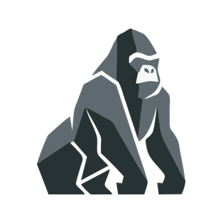

# GORILA SOFTWARE HOUSE

**Desenvolvimento Robusto. Arquitetura Sênior.**

Software house brasileira especializada em arquitetura de software de alto padrão, liderada por profissionais seniores. 
Transformamos complexidade em soluções sólidas, estruturadas e escaláveis, que evoluem junto com o negócio do cliente.

---

## Sobre nós

A Gorila nasceu da convicção de que software robusto é a base de negócios sólidos. Combinamos expertise técnica com visão de negócio para desenvolver sistemas que não apenas funcionam: eles evoluem com a empresa, mantendo a estabilidade e a performance necessárias para crescer com confiança.

Cada projeto é tratado com o mesmo compromisso: entregar tecnologia que transmite solidez, autoridade e resultados mensuráveis.

## O que fazemos

<table>
  <tr>
    <td width="50%" valign="top">
      <h3>Sistemas sob medida</h3>
      Aplicações web, APIs e plataformas multiusuário (SaaS).
    </td>
    <td width="50%" valign="top">
      <h3>Arquitetura e consultoria</h3>
      Desenho de soluções, modelagem de domínio e decisões documentadas.
    </td>
  </tr>
  <tr>
    <td valign="top">
      <h3>Aplicativos mobile</h3>
      Apps multiplataforma integrados às nossas APIs.
    </td>
    <td valign="top">
      <h3>Automação e integrações</h3>
      Scripts, filas, webhooks e conexão entre sistemas.
    </td>
  </tr>
  <tr>
    <td colspan="2" valign="top">
      <h3>Infraestrutura e entrega</h3>
      Containers, CI/CD e deploy com foco em estabilidade.
    </td>
  </tr>
</table>

## Por que a Gorila

- **Arquitetura desde o primeiro commit:** a solução é pensada para escalar antes de crescer.
- **Código limpo, testado e documentado:** manutenção previsível e evolução sem sustos.
- **Atendimento direto:** você fala com quem projeta e desenvolve, sem intermediários.
- **Tecnologia escolhida pelo problema:** stack moderna, adotada por critério técnico e não pela moda.
- **Liderança sênior:** mais de 13 anos de liderança técnica à frente dos projetos.

## Como trabalhamos

| 1. Descoberta | 2. Arquitetura | 3. Desenvolvimento | 4. Entrega e suporte |
|---|---|---|---|
| Entendemos o negócio, o problema e as restrições antes de escrever código. | Desenhamos a solução, modelamos o domínio e documentamos as decisões. | Código limpo e testado, com entregas incrementais e comunicação direta. | Deploy automatizado, foco em estabilidade e acompanhamento na evolução. |

## Stack

**Backend** 

**Frontend** 

**Banco de dados** 

**Infraestrutura** 

**Mobile** 

## Carreiras

Buscamos profissionais que valorizam código limpo, documentação e boas práticas: desenvolvedores com visão de sistema, que gostam de resolver problemas complexos e de aprender constantemente. Ambiente técnico, projetos desafiadores e liberdade para propor melhorias.

Envie seu currículo e uma breve apresentação para [contato@gorilash.com.br](mailto:contato@gorilash.com.br) com o assunto "Carreiras".

---

### Pronto para elevar o padrão da sua arquitetura de software?

Entre em contato e vamos construir algo robusto.

[www.gorilash.com.br](https://www.gorilash.com.br/)

